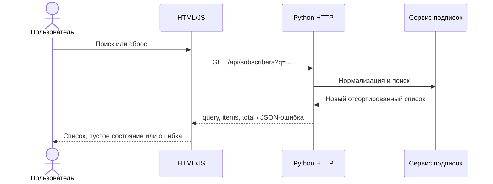

# Implementation Plan: поиск подписчиков

**Branch**: practice_05 | **Date**: 2026-10-26 | **Spec**: spec.md.
Контракт утверждён пользователем до реализации; baseline — три теста практики 4 OK.

## Summary

Продолжить существующий сервис: добавить чистую функцию поиска, GET API и один
экран. Логику и UI реализуют отдельные агенты по общему контракту; интеграцию,
сквозные проверки и итоговые документы выполняет координатор.

## Technical Context

- **Language/Version**: Python 3.10+, современный браузер с fetch/AbortController.
- **Primary Dependencies**: standard library; HTML/CSS/JavaScript без сборки.
- **Storage**: существующий set в памяти; явный --demo.
- **Testing**: unittest для логики/HTTP, Playwright для браузера.
- **Target Platform**: Windows и WSL/Linux, локальный запуск на 127.0.0.1:8765.
- **Project Type**: небольшой веб-интерфейс существующего Python-сервиса.
- **Constraints**: один origin, без БД/авторизации/HTTP CRUD; без замены старых функций.
- **Scale/Scope**: учебный небольшой список; линейный поиск и прежняя сортировка.

## Constitution Check

- Спеки двух команд и контракт подготовлены до кода; исходные версии сохранены.
- Пользователь ответил «Утверждаю, реализуй»; запись — evidence/human-approval.json.
- Старые функции покрываются регрессиями; используются только необходимые зависимости.
- Автоматические результаты дополняются независимой проверкой и реальным браузером.

## Project Structure

```text
app/
  service.py              # старые функции + поиск
  server.py               # локальный HTTP-сервер, API и статические файлы
  static/                 # index.html, app.js, style.css
tests/
  test_service.py          # unit и регрессии
  test_http.py             # реальный локальный HTTP
  e2e.cjs                  # браузерные сценарии
specs/
  before/                 # неизменённые независимые исходные спеки
  after/                  # редакции после сверки
  001-subscriber-search/   # артефакты Spec Kit и общий контракт
evidence/                 # фактические результаты и демонстрация
```

## Design



HTTP-слой проверяет структуру query string и кодирование. Сервис проверяет тип,
strip и длину; чистая функция поиска не меняет set. Static routes имеют явный
список файлов. UI отправляет raw query, принимает серверную нормализацию,
предотвращает устаревший ответ и выводит данные как текст.

## Verification

Сначала unit и HTTP; затем реальный браузер: начальный список, поиск и кириллица,
пустой результат, сброс, 101 символ, retry, некорректный ответ и устаревший запрос.
Отдельный агент повторно запускает проверки и сопоставляет их с контрактом.
