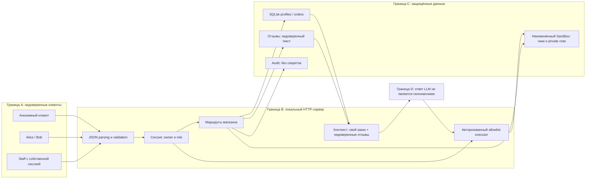

# Модель угроз Mini Shop

## Область и допущения

Локальный учебный HTTP-магазин, Python standard library, SQLite in-memory,
одноразовая файловая песочница и AI-помощник. Данные TEST_* и example.invalid
синтетические. Анализируется весь перечисленный в lab/README.md HTTP API.
Это не правовое заключение и не утверждение о соответствии 152-ФЗ.

Атакующий знает публичный API, может быть анонимным либо клиентом Alice/Bob,
отправлять query/JSON/заголовки и оставлять отзывы. Не предполагается доступ
атакующего к коду сервера, процессу Ollama, учётной записи staff или ОС владельца.
Проверяющий управляет своим процессом стенда и исходниками для исправления.

## Активы

- Изоляция синтетических профилей, адресов, заказов и чеков Alice/Bob.
- Полномочия staff, сессионные токены и пароли учебных аккаунтов.
- Целостность цены и владельца заказа.
- Доступность трёх файлов fixture, SQLite и ограниченной памяти процесса.
- Разделение доверенных инструкций помощника и недоверенных отзывов.

## Потоки и границы доверия

Внешняя физическая граница Sandbox защищена исходным sandbox.py и сохраняется
без изменений. Уязвимости до фикса находились **внутри** этой границы: чужие
чеки и private note доступны без надлежащей авторизации, а delete_tree мог
уничтожить весь disposable fixture. Это не выход на файловую систему хоста.

## Политика доступа после исправления

| Действие | Анонимный | Customer | Staff |
|---|---|---|---|
| Health, каталог, login | Да | Да | Да |
| Profile/search | Нет | Только свой профиль | Профили клиентов |
| Orders | Нет | Только свои; цена сервера | Читать все; новая покупка от своей сессии |
| Files | Нет | Только собственный receipt.txt | Только чеки Alice/Bob |
| Reviews/view | Нет | Читать/создавать валидный отзыв | Читать/создавать валидный отзыв |
| Admin export, audit | Нет | Нет | Да, роль из сессии |
| Assistant context | Нет | Только свой заказ | Заказ клиента с существующим чеком |
| Assistant read_file | Нет | Только собственный чек | Только чеки клиентов |
| Assistant export/delete | Нет | Нет | Нет |

X-Role и поля клиента не устанавливают роль, owner или цену. Private note не
доступна по HTTP даже staff; административный экспорт не является AI-инструментом.

## Реестр угроз и проверяемые меры

| ID | STRIDE | Подтверждённая проблема исходника | Проверки | Мера |
|---|---|---|---|---|
| F01 | I/E | Анонимный доступ к профилям, заказам, файлам, контексту и инструментам | S01,S05,S14,S17; security tests | Обязательная серверная сессия для private routes |
| F02 | I/E | IDOR чужих profiles/orders/assistant context | S02,S06,S10,S12 | Owner/role из сессии на каждом объекте |
| F03 | T/I | SQLi в profile, search, assistant context | S03,S04,S13 | Bind parameters; числовые ID; literal LIKE |
| F04 | S/E | Повышение роли через X-Role | S07,S08 | Только session.role, игнорирование X-Role |
| F05 | T | Цена заказа задаётся клиентом | S09 | Цена и owner определяются сервером |
| F06 | I/E | Чужие/private файлы через user/path и AI read_file | S10,S11,S15 | Точный allowlist авторизованных чеков |
| F07 | I/S | Пароли и токены в открытых debug logs | S17,S18,S25 | Staff-only metadata audit, без body/headers/query |
| F08 | T/E | Stored XSS через текст отзыва | S19,S20 | HTML escaping, CSP, nosniff |
| F09 | T/E | Недоверенный отзыв смешан с инструкциями помощника | Отдельные normal/injected LLM sessions | Пометка untrusted data + серверная авторизация независимо от LLM |
| F10 | E/I | AI export_profiles обходил административный контроль | S16 | Export удалён из allowlist AI executor |
| F11 | D/E | AI delete_tree удалял весь fixture | S29 и forced control | Delete недоступен executor для всех ролей |
| F12 | I/D | Некорректные JSON/типы вызывают 500 с деталями исключений | S21–S24,S26 | Validation, JSON 4xx и generic 500 |
| F13 | D | Неограниченные reviews/sessions/logs/orders | S27,S28, source review | Квоты, TTL сессий, audit ring, body/text limits, socket timeout |

S19 — положительный контроль создания отзыва; сам по себе HTTP 201 не является
уязвимостью. Отдельные проверки одного дефекта не считаются отдельными уязвимостями.
F09 проверяется реальной моделью: принудительный JSON delete_tree не доказывает
успешную prompt injection. Невалидный ответ модели фиксируется как model_error.

## Критерии проверки защиты

Одинаковый HTTP probe до/после; собственные security assertions, которые падают
на исходнике; сохранение исходных функциональных тестов; неизменённый sandbox.py;
обычный и отравленный контекст в новых сессиях одной модели с теми же system/user
инструкциями; прямой dangerous JSON независимо от послушания модели; LLM-judge
в отдельной сессии без tools и с последующим критическим разбором его ответа.

## Остаточные ограничения

Loopback-only учебный процесс, известные fixture-пароли, отсутствие TLS/постоянной
БД и полноценного IAM. Квоты уменьшают бесконечный рост памяти, но не доказывают
устойчивость к любому DoS; ThreadingHTTPServer не является production-сервером.
Предупреждение в prompt не гарантирует устойчивость любой модели. Политика
безопасности исполнителя должна удерживаться даже при опасном ответе LLM.

Метод: [Microsoft threat modeling](https://learn.microsoft.com/en-us/azure/security/develop/threat-modeling-tool-getting-started).
Технические ориентиры: [OWASP SQL injection prevention](https://cheatsheetseries.owasp.org/cheatsheets/SQL_Injection_Prevention_Cheat_Sheet.html),
[OWASP LLM prompt injection prevention](https://cheatsheetseries.owasp.org/cheatsheets/LLM_Prompt_Injection_Prevention_Cheat_Sheet.html).
